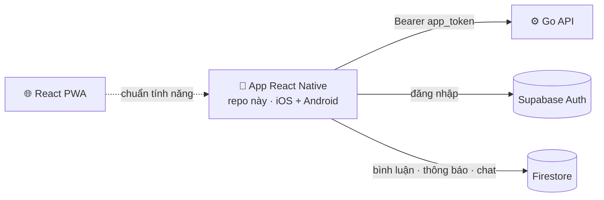

<div align="center">


# Checkpoint — Mobile (React Native)

**Bản app native iOS / Android của Checkpoint, port từ web PWA sang Expo để có camera, định vị và bản đồ mượt như app thật.**


<br/>
[](https://checkpoint-app.space)
[](https://github.com/handao2303/checkpoint-app)

</div>

---

## 🧭 Vai trò trong hệ thống



Dùng chung Go API và dữ liệu với bản web; bản web là chuẩn tính năng để app bám theo (mục tiêu: **parity với web**).

---

## 📊 Trạng thái

| Hạng mục | Tình trạng |
|---|---|
| Port toàn bộ màn hình từ PWA | ✅ 15 màn hình |
| Bản đồ (MapLibre native) | ✅ đã đạt parity với web |
| Đăng nhập, Khách, deep link | ✅ |
| Cấu hình build iOS / Android (EAS) | ✅ profile `development` · `preview` (APK) · `production` |
| Phát hành lên store | ⏳ chưa |

---

## ✨ Màn hình

**Tab chính:** Bản đồ · Khám phá · Bảng xếp hạng
**Chi tiết:** Check-in · Địa điểm · Hành trình · Hồ sơ người dùng
**Tạo & tương tác:** Tạo check-in (camera, thư viện ảnh) · Feed · Chat · Huy hiệu · Hồ sơ cá nhân

Deep link: `checkpoint://` và đường dẫn `/c/:id` · `/p/:id` · `/j/:id` · `/u/:userId` mở thẳng đúng màn hình.
Song ngữ Việt / Anh (`src/lib/locales/vi.json`, `en.json`).

---

## 🚀 Chạy local

```bash
npm install
npx expo start            # Expo Dev Client
npm run android           # hoặc: npm run ios
```

Build cài thử: `eas build --profile preview --platform android` (ra file APK).

> Dự án dùng Expo SDK 56 — đọc tài liệu đúng phiên bản tại [docs.expo.dev/versions/v56.0.0](https://docs.expo.dev/versions/v56.0.0/) trước khi sửa code (xem `AGENTS.md`).

---

## 📂 Cấu trúc

```
App.tsx · index.ts
src/
├── navigation/     RootNavigator · TabNavigator · LinkingConfig (deep link)
├── screens/        15 màn hình + 1 placeholder
├── components/     ui · nav · chat
├── auth/ · context/
├── lib/            api · locales (vi, en)
├── location/ · hooks/ · theme/ · icons/ · types/
plugins/            config plugin (lọc ABI Android)
eas.json            profile build EAS
```

<div align="center">
<sub>Một phần của <a href="https://github.com/handao2303/checkpoint-app">Checkpoint</a> · <a href="https://checkpoint-app.space">checkpoint-app.space</a></sub>
</div>
